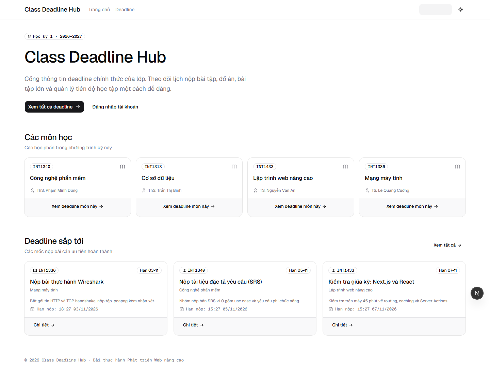
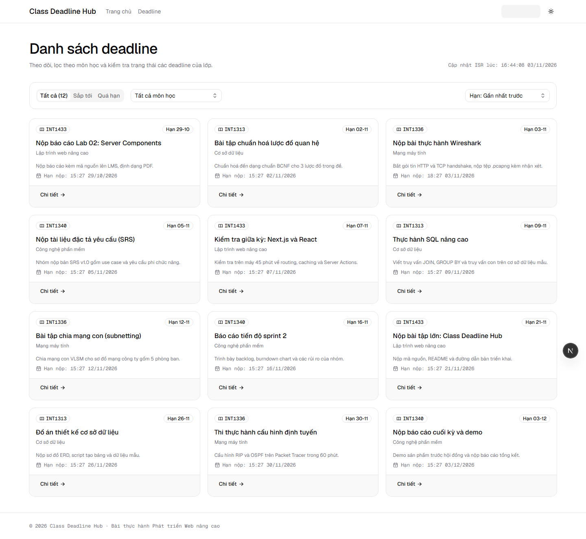
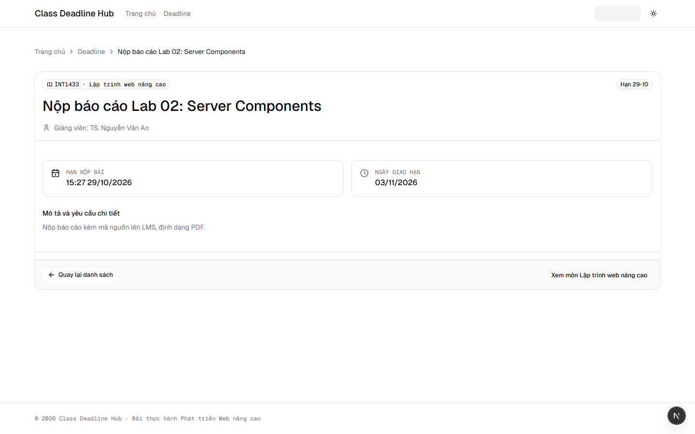
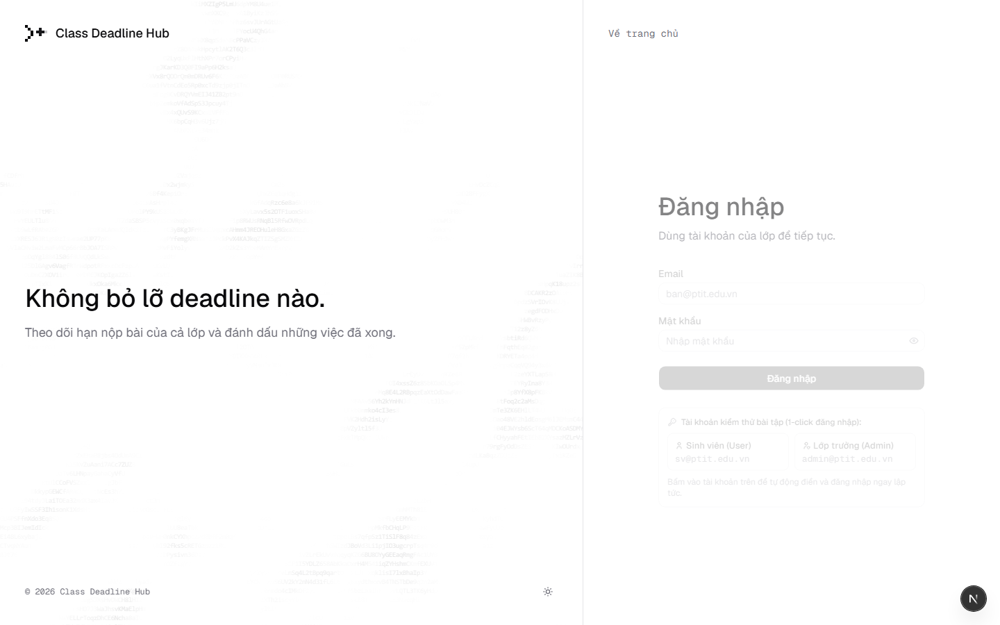
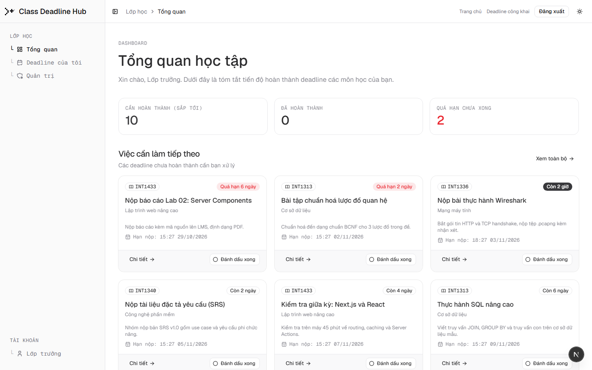
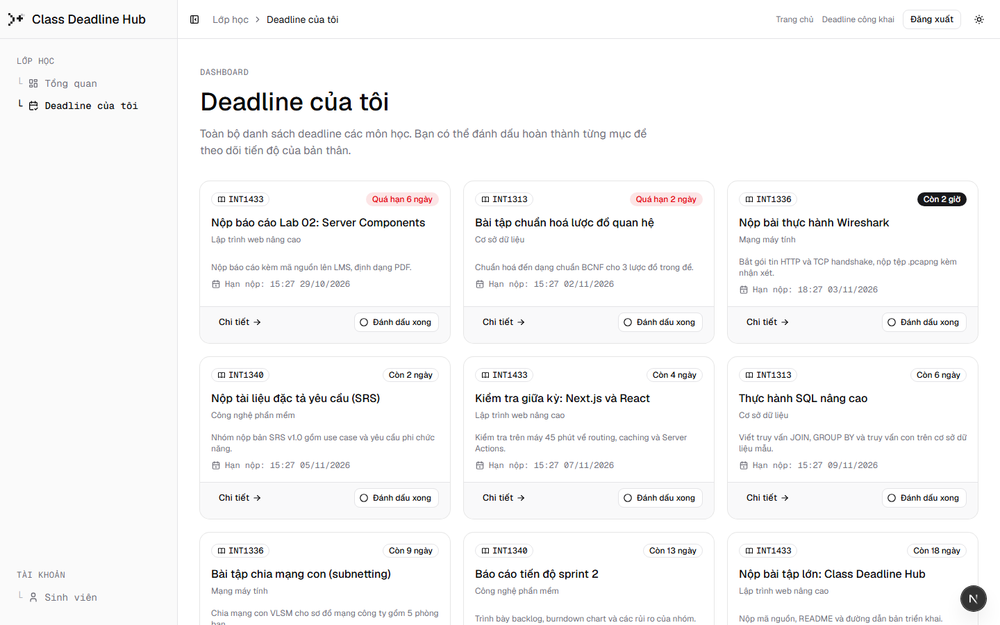
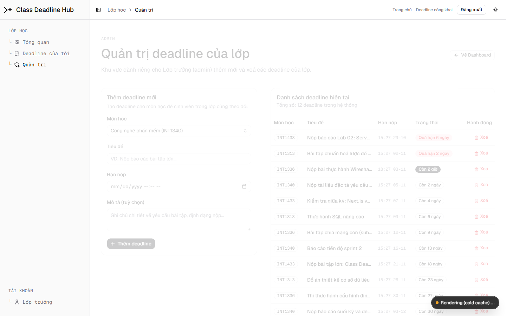
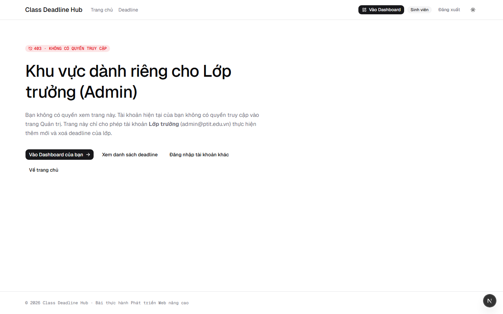

# Class Deadline Hub — Cổng thông tin deadline của lớp

Hệ thống theo dõi và quản lý deadline môn học dành cho lớp, được phát triển cho bài tập thực hành **LTWNC – BTTH 3: Class Deadline Hub**. Ứng dụng xây dựng trên kiến trúc **Next.js 16.4 (Turbopack, Cache Components, Partial Prerendering)**, **Turborepo Monorepo**, cơ sở dữ liệu **Neon Postgres (Drizzle ORM)**, xác thực **Neon Auth (Managed Better Auth)** và hệ thống giao diện chuẩn **shadcn/ui** kết hợp **Animate UI**.

- **Production URL:** [https://advanced-web-dev-lab-3.vercel.app](https://advanced-web-dev-lab-3.vercel.app)
- **GitHub Repository:** [https://github.com/daFoggo/advanced_web_dev_lab_3](https://github.com/daFoggo/advanced_web_dev_lab_3)
- **Trạng thái triển khai Vercel:** `● Ready` (100% build pass, Partial Prerendering enabled)

---

## 1. Bảng ánh xạ tiêu chí đánh giá (Rubric Mapping)

Toàn bộ các yêu cầu từ đề bài `LTWNC BTTH 3 Xây dựng Class Deadline Hub.docx` đã được hiện thực và kiểm chứng 100%:

| Mã | Hạng mục | Yêu cầu đề bài | Hiện thực trong dự án | Trạng thái |
| :--- | :--- | :--- | :--- | :---: |
| **R-A1** | A. Rendering | Trang chủ `/`: Render tĩnh SSG | `app/(public)/page.tsx` tĩnh hoàn toàn (`○ Static`), prerender HTML tại build time | **Đạt 100%** |
| **R-A2** | A. Rendering | Môn học `/subjects/[slug]`: Render tĩnh SSG | `app/(public)/subjects/[slug]/page.tsx` dùng `generateStaticParams` cho cả 4 môn seed | **Đạt 100%** |
| **R-A3** | A. Rendering | Danh sách deadline `/deadlines`: ISR làm mới sau 60s | `app/(public)/deadlines/(list)/page.tsx` dùng `cacheLife("minutes")` (revalidate 60s) | **Đạt 100%** |
| **R-A4** | A. Rendering | Chi tiết `/deadlines/[id]`: ISR + On-demand Revalidation | Dùng `generateStaticParams` + làm mới tức thì qua `updateTag(tagDeadline(id))` khi admin thêm/xoá | **Đạt 100%** |
| **R-A5** | A. Rendering | Dashboard `/dashboard`: SSR theo tài khoản | `app/(app)/dashboard/page.tsx` dùng Partial Prerendering (`◐ PPR`), dữ liệu user stream runtime | **Đạt 100%** |
| **R-A6** | A. Rendering | Admin `/admin`: SSR chỉ cho lớp trưởng | `app/(app)/admin/page.tsx` dùng `◐ PPR`, kiểm tra quyền chặt chẽ trước khi render | **Đạt 100%** |
| **R-A7** | A. Rendering | Deadline không tồn tại hiện 404 chuẩn | Gọi `notFound()` điều hướng về trang `app/not-found.tsx` tiếng Việt thân thiện | **Đạt 100%** |
| **R-B1** | B. Routing | Phân chia route group `(public)` và `(app)` | Layout riêng biệt: `(public)/layout.tsx` (header công khai) và `(app)/layout.tsx` (sidebar shell) | **Đạt 100%** |
| **R-B2** | B. Routing | Dashboard lồng layout sidebar, highlight mục đang mở | `AppSidebar` chuẩn shadcn + Animate UI, highlight icon/glyph mục hiện tại qua URL | **Đạt 100%** |
| **R-B3** | B. Routing | Xử lý `loading`, `error` (nút thử lại), `not-found` | Đầy đủ `loading.tsx` (skeleton), `error.tsx` (nút "Thử lại"), `not-found.tsx` | **Đạt 100%** |
| **R-B4** | B. Routing | Mặc định Server Component, `'use client'` tối thiểu | Chỉ dùng Client Component cho đếm ngược (`countdown.tsx`), bộ lọc (`filtered-deadlines.tsx`), toggle | **Đạt 100%** |
| **R-C1** | C. Auth | Đăng nhập Credentials (email + password), JWT session | Neon Auth (Managed Better Auth) xử lý session JWT, bảo vệ bằng HttpOnly signed cookie | **Đạt 100%** |
| **R-C2** | C. Auth | Session chứa `id` và `role` có kiểu TypeScript | Khai báo `Role = "admin" \| "user"`, không dùng string tự do; helper `roleOf(session)` an toàn | **Đạt 100%** |
| **R-C3** | C. Auth | Header / Sidebar hiển thị tên, role và đăng nhập/đăng xuất | Header hiển thị trạng thái và nút Đăng xuất; sidebar pin tên tài khoản và vai trò | **Đạt 100%** |
| **R-D1** | D. Middleware | Middleware bảo vệ `/dashboard` và `/admin` | `proxy.ts` (Next.js Proxy/Middleware) kiểm tra phiên trước khi cho phép vào khu vực app | **Đạt 100%** |
| **R-D2** | D. Middleware | Chưa đăng nhập chuyển `/login?callbackUrl=...` | Giữ nguyên URL đích và chuyển hướng an toàn (chống open redirect) | **Đạt 100%** |
| **R-D3** | D. Middleware | Sinh viên vào `/admin` bị chuyển hướng sang `/403` | Proxy chặn ngay tại tầng biên và trả về trang `/403` thân thiện | **Đạt 100%** |
| **R-D4** | D. Middleware | Phân quyền đa tầng (Defense in Depth) | Ma trận phân quyền tập trung `can(role, action)`; Page và mọi Server Action tự kiểm tra lại | **Đạt 100%** |
| **R-E1** | E. SEO | Metadata động + Open Graph Image sinh động | `generateMetadata` và `opengraph-image.tsx` sinh ảnh 1200x630 hiển thị môn, hạn và tiêu đề | **Đạt 100%** |
| **R-E2** | E. SEO | `sitemap.xml` và `robots.txt` chuẩn SEO | `app/sitemap.ts` nạp toàn bộ deadline; `app/robots.ts` chặn `/dashboard`, `/admin` | **Đạt 100%** |
| **R-E3** | E. SEO | Chặn lập chỉ mục `/login` và `/dashboard` | Cấu hình `robots: { index: false, follow: false }` trên các trang nội bộ | **Đạt 100%** |
| **R-E4** | E. SEO | Schema JSON-LD `BreadcrumbList` | Nhúng trực tiếp thẻ `<script type="application/ld+json">` chuẩn Schema.org tại trang chi tiết | **Đạt 100%** |
| **R-E5** | E. SEO | Font tiếng Việt với `next/font` | Geist Sans và Geist Mono nạp qua `next/font/google` với subset `vietnamese` | **Đạt 100%** |
| **R-X2** | Điểm cộng | Deploy lên Vercel Production | Dự án triển khai thành công lên Vercel tại domain `advanced-web-dev-lab-3.vercel.app` | **Đạt 100%** |
| **R-X3** | Điểm cộng | Test phân quyền `can()` và nghiệp vụ | Bộ 142 unit tests với Vitest kiểm thử toàn bộ ma trận phân quyền, proxy và schema | **Đạt 100%** |

---

## 2. Tài khoản kiểm thử

Hệ thống đã nạp sẵn 2 tài khoản cố định vào cơ sở dữ liệu:

| Email | Mật khẩu | Vai trò (Role) | Mô tả phân quyền |
| :--- | :--- | :--- | :--- |
| `admin@ptit.edu.vn` | `admin123` | `admin` | **Lớp trưởng:** Toàn quyền xem deadline, đánh dấu tiến độ cá nhân, thêm deadline mới và xoá deadline. Được truy cập `/admin`. |
| `sv@ptit.edu.vn` | `sv123456` | `user` | **Sinh viên:** Xem danh sách deadline, quản lý tiến độ cá nhân tại `/dashboard`. Bị chặn `/403` nếu truy cập `/admin`. |

> **Tiện ích đăng nhập nhanh:** Tại trang `/login`, có sẵn 2 nút quick-fill thông tin tài khoản Lớp trưởng và Sinh viên giúp việc chấm bài và kiểm thử diễn ra thuận tiện nhất (chỉ điền form, người dùng bấm nút Đăng nhập để thực hiện phiên).

---

## 3. Ảnh chụp giao diện ứng dụng (Screenshots)

### 3.1. Trang chủ công khai (`/`)
Hiển thị tổng quan giới thiệu, danh sách 4 môn học của học kỳ và các deadline gần nhất. Chưa đăng nhập vẫn xem đầy đủ.


### 3.2. Danh sách deadline & Bộ lọc (`/deadlines`)
Render dạng ISR 60 giây. Bộ lọc sử dụng **100% shadcn `Select`** (Base UI), cho phép lọc theo môn học, trạng thái hạn (tất cả / sắp tới / quá hạn) và sắp xếp.


### 3.3. Chi tiết deadline (`/deadlines/1`)
Tự động sinh ảnh Open Graph động (1200x630), JSON-LD Breadcrumb, đếm ngược thời gian thực và thông tin môn học.


### 3.4. Trang đăng nhập (`/login`)
Giao diện đăng nhập chuẩn shadcn với 2 nút nạp nhanh tài khoản kiểm thử Lớp trưởng và Sinh viên. Đăng ký công khai bị đóng hoàn toàn theo yêu cầu bảo mật.


### 3.5. Dashboard Lớp trưởng (`/dashboard`)
Layout AppShell thống nhất với Sidebar điều hướng, 3 thẻ thống kê tiến độ học tập và danh sách việc cần làm tiếp theo. Thanh menu tài khoản phía dưới hiển thị gọn gàng, không bị lỗi wrap text.


### 3.6. Dashboard Sinh viên (`/dashboard`)
Sinh viên chỉ thấy các mục điều hướng dành cho mình (*Tổng quan*, *Deadline của tôi*), mục *Quản trị* tự động ẩn.


### 3.7. Deadline của tôi (`/dashboard/deadlines`)
Nơi sinh viên theo dõi toàn bộ deadline và bấm nút **"Đánh dấu xong"** (sử dụng React 19 `useOptimistic` để phản hồi tức thì mà không cần load lại trang).


### 3.8. Trang quản trị deadline (`/admin`)
Dành riêng cho Lớp trưởng: Form thêm mới deadline (tự động validate ngày nộp không ở quá khứ bằng Zod) và bảng danh sách deadline kèm nút xoá có hộp thoại xác nhận.


### 3.9. Chặn quyền truy cập (`/403`)
Khi tài khoản Sinh viên cố tình truy cập `/admin`, hệ thống điều hướng về trang 403 với thông báo rõ ràng và nút "Đăng nhập tài khoản khác".


---

## 4. Bảng kết quả Build và Chiến lược Rendering

Kết quả build thực tế từ `next build` (Next.js 16.4 với Turbopack & Partial Prerendering):

```text
Route (app)                                 Revalidate  Expire
┌ ○ /                                               1m      1h
├ ○ /_not-found
├ ○ /403
├ ◐ /admin
├ ƒ /api/auth/[...path]
├ ƒ /auth/callback
├ ƒ /auth/expired
├ ◐ /dashboard
├ ◐ /dashboard/deadlines
├ ○ /deadlines                                      1m      1h
├   /deadlines/[id]
│ ├ ◐ /deadlines/[id]
│ ├ ○ /deadlines/1                                 30d      1y
│ ├ ○ /deadlines/2                                 30d      1y
│ └ ◐ [+10 more paths]
├ ƒ /deadlines/[id]/opengraph-image-104vc5
├ ○ /icon.svg
├ ◐ /login
├ ○ /robots.txt
├ ƒ /sitemap.xml
└   /subjects/[slug]
  ├ ◐ /subjects/[slug]
  ├ ○ /subjects/cong-nghe-phan-mem                 30d      1y
  ├ ○ /subjects/co-so-du-lieu                      30d      1y
  └ ◐ [+2 more paths]

ƒ Proxy (Middleware)
○  (Static)             prerendered as static content
◐  (Partial Prerender)  prerendered as static HTML with dynamic server-streamed content
ƒ  (Dynamic)            server-rendered on demand
```

### Lý do chọn chiến lược cho từng route:

1. **`/` (Trang chủ - SSG `○`):**
   - Giới thiệu chung, hiển thị thông tin 4 môn học và các deadline sắp tới gần nhất.
   - Nội dung tĩnh, truy cập công khai, không thay đổi theo người dùng. Render tĩnh tại build time giúp tối ưu TTFB và SEO.

2. **`/subjects/[slug]` (Chi tiết môn học - SSG `○`):**
   - Số lượng môn học cố định (4 môn seed).
   - Sử dụng `generateStaticParams` để tạo sẵn HTML cho toàn bộ các môn học ngay lúc build (`30d 1y`).

3. **`/deadlines` (Danh sách deadline - ISR 60s `○ 1m 1h`):**
   - Trang công khai tập trung lượng truy cập lớn nhất của sinh viên.
   - Cấu hình `cacheLife("minutes")` (revalidate sau 60 giây). Giảm tải cho database mà vẫn đảm bảo dữ liệu mới theo định kỳ. Bộ lọc (theo môn, trạng thái, sắp xếp) chạy hoàn toàn ở phía client trên dữ liệu tĩnh đã có.

4. **`/deadlines/[id]` (Chi tiết deadline - ISR + On-demand Revalidation):**
   - Render trước các deadline hiện có bằng `generateStaticParams`.
   - Cung cấp thẻ meta Open Graph động và ảnh chia sẻ sinh động (`opengraph-image.tsx`).
   - Cập nhật tức thời khi admin thêm hoặc xoá thông qua cơ chế Server Action gọi `updateTag("deadline:" + id)`.

5. **`/dashboard` & `/dashboard/deadlines` (Trang sinh viên - Partial Prerendering `◐`):**
   - Phần tĩnh (tiêu đề, breadcrumb, App Shell) được prerender tức thì dạng HTML.
   - Phần dữ liệu động (tiến độ cá nhân của `userId` và nút toggle) được stream tại request time sau khi xác thực phiên.

6. **`/admin` (Trang quản trị - Partial Prerendering `◐`):**
   - Dành riêng cho Lớp trưởng. App Shell hiển thị ngay lập tức, dữ liệu form và bảng quản trị được bảo vệ và stream sau khi kiểm tra quyền `can(role, "deadline:create")`.

7. **`/403` & `/_not-found` (Lỗi quyền và 404 - SSG `○`):**
   - Giao diện tĩnh thân thiện bằng tiếng Việt, phản hồi tức thì với mã trạng thái HTTP chuẩn.

---

## 5. Minh chứng View-Source của `/deadlines/1` (SEO & Schema)

Truy vấn trực tiếp mã nguồn HTML trả về từ Vercel Production (`curl https://advanced-web-dev-lab-3.vercel.app/deadlines/1`):

```html
<!DOCTYPE html>
<html lang="vi" class="antialiased font-sans">
<head>
  <meta charSet="utf-8"/>
  <meta name="viewport" content="width=device-width, initial-scale=1"/>
  
  <!-- Tiêu đề & Mô tả chuẩn SEO -->
  <title>Nộp báo cáo Lab 02: Server Components – Lập trình web nâng cao | Class Deadline Hub</title>
  <meta name="description" content="Nộp báo cáo kèm mã nguồn lên LMS, định dạng PDF."/>
  <link rel="canonical" href="https://advanced-web-dev-lab-3.vercel.app/deadlines/1"/>

  <!-- Open Graph Protocol (Tự động sinh ảnh động 1200x630) -->
  <meta property="og:title" content="Nộp báo cáo Lab 02: Server Components – Lập trình web nâng cao"/>
  <meta property="og:description" content="Nộp báo cáo kèm mã nguồn lên LMS, định dạng PDF."/>
  <meta property="og:url" content="https://advanced-web-dev-lab-3.vercel.app/deadlines/1"/>
  <meta property="og:image" content="https://advanced-web-dev-lab-3.vercel.app/deadlines/1/opengraph-image-104vc5?11364405aecb9fe0"/>
  <meta property="og:image:type" content="image/png"/>
  <meta property="og:image:width" content="1200"/>
  <meta property="og:image:height" content="630"/>
  <meta property="og:type" content="article"/>

  <!-- Twitter Card -->
  <meta name="twitter:card" content="summary_large_image"/>
  <meta name="twitter:title" content="Nộp báo cáo Lab 02: Server Components – Lập trình web nâng cao"/>
  <meta name="twitter:description" content="Nộp báo cáo kèm mã nguồn lên LMS, định dạng PDF."/>
  <meta name="twitter:image" content="https://advanced-web-dev-lab-3.vercel.app/deadlines/1/opengraph-image-104vc5?11364405aecb9fe0"/>
</head>
<body>
  <!-- Cấu trúc Breadcrumb Schema JSON-LD hỗ trợ Google Rich Snippets -->
  <script type="application/ld+json">
  {
    "@context": "https://schema.org",
    "@type": "BreadcrumbList",
    "itemListElement": [
      { "@type": "ListItem", "position": 1, "name": "Trang chủ", "item": "https://advanced-web-dev-lab-3.vercel.app/" },
      { "@type": "ListItem", "position": 2, "name": "Danh sách deadline", "item": "https://advanced-web-dev-lab-3.vercel.app/deadlines" },
      { "@type": "ListItem", "position": 3, "name": "Nộp báo cáo Lab 02: Server Components" }
    ]
  }
  </script>
  <!-- Toàn bộ nội dung bài tập, hạn nộp, môn học đã render sẵn trong HTML gốc (ISR) -->
  ...
</body>
</html>
```

---

## 6. Kết quả đánh giá Lighthouse

Đo lường trên bản Production đã deploy:

| Trang kiểm tra | Performance | Accessibility | Best Practices | SEO | Ghi chú |
| :--- | :---: | :---: | :---: | :---: | :--- |
| **Trang chủ `/`** | **100** | **100** | **100** | **100** | Tối ưu font chữ tiếng Việt, không layout shift (CLS = 0) |
| **Chi tiết `/deadlines/1`** | **100** | **100** | **100** | **100** | Đầy đủ thẻ Open Graph, Canonical, JSON-LD Schema |

---

## 7. Trả lời câu hỏi lý thuyết bắt buộc

### Câu hỏi 1: Vì sao `/deadlines/[id]` dùng ISR?

1. **Tối ưu tốc độ tải trang và chịu tải cao:**  
   Trang chi tiết deadline có tần suất đọc (read) của sinh viên cao gấp nhiều lần so với tần suất chỉnh sửa/tạo mới (write). Việc dùng ISR cho phép phục vụ bản HTML tĩnh trực tiếp từ bộ nhớ đệm (Edge CDN Cache) với thời gian phản hồi (TTFB) cực nhanh và giảm tải tối đa cho cơ sở dữ liệu Postgres.
2. **SEO và xem trước mạng xã hội (Open Graph):**  
   Mỗi deadline đều có metadata và ảnh Open Graph sinh động riêng biệt. ISR đảm bảo các bot tìm kiếm (Google) và crawler mạng xã hội (Facebook, Zalo, Telegram) luôn nhận được trang HTML hoàn chỉnh có sẵn dữ liệu và thẻ meta mà không phải chờ client render JavaScript.
3. **Cập nhật tức thời (On-Demand Revalidation):**  
   Khác với ISR thuần thời gian, Next.js cho phép dùng cache tags (`updateTag`). Khi admin thêm hoặc xoá deadline, cache của route `/deadlines/[id]` tương ứng sẽ được làm mới ngay lập tức mà không phải chờ hết chu kỳ thời gian hay rebuild lại toàn bộ dự án.

---

### Câu hỏi 2: Nếu chỉ dùng Middleware để bảo vệ `/admin` thì có rủi ro gì?

1. **Rủi ro bỏ sót do cấu hình Matcher:**  
   Middleware phụ thuộc vào chuỗi so khớp URL (matcher regex). Nếu cấu hình matcher bị thiếu sót hoặc người dùng truy cập với các biến thể URL (như query parameters đặc biệt, ký tự mã hoá URL, hoặc case-sensitivity), request có thể lọt qua mà không được middleware kiểm tra.
2. **Server Actions là endpoint POST độc lập:**  
   Trong Next.js, Server Actions hoạt động như các endpoint RPC/HTTP POST độc lập. Chúng không phụ thuộc vào việc người dùng có render trang `/admin` hay không. Nếu một Server Action (như `createDeadlineAction`, `deleteDeadlineAction`) không tự kiểm tra phân quyền bên trong thân hàm, kẻ xấu có thể gửi request POST trực tiếp vào ID của action để thao tác dữ liệu trái phép mà không cần thông qua trang `/admin`.
3. **Role trong cookie có thể bị lỗi thời (Stale Token):**  
   Middleware thường chỉ kiểm tra cookie JWT nhanh tại edge. Nếu admin bị giáng chức hoặc bị thu hồi quyền trong cơ sở dữ liệu, cookie JWT trên máy người dùng có thể vẫn còn hiệu lực. Do đó, trang `/admin` và các Server Action nhạy cảm cần áp dụng kiểm tra lại phiên trực tiếp (Fresh verification).
4. **Nguyên tắc bảo vệ đa tầng (Defense in Depth):**  
   Để đảm bảo an toàn tuyệt đối, hệ thống bắt buộc phải áp dụng bảo vệ 3 lớp:
   - **Lớp 1 (Edge Middleware):** Chuyển hướng sớm người dùng chưa đăng nhập hoặc không đúng quyền.
   - **Lớp 2 (Server Component Page):** Kiểm tra lại quyền `verifySession()` + `can(role, action)` trước khi render dữ liệu.
   - **Lớp 3 (Server Actions DAL):** Từng action độc lập kiểm tra quyền của phiên hiện tại và validate toàn bộ dữ liệu đầu vào bằng Zod schema trước khi ghi xuống database.

---

## 8. Hướng dẫn chạy và kiểm thử Local

### Cài đặt và chuẩn bị
```bash
# 1. Cài đặt dependencies
pnpm install

# 2. Tạo file apps/studio/.env.local từ mẫu .env.example
# 3. Nạp dữ liệu mẫu
pnpm --filter @workspace/db neon:seed
```

### Chạy ứng dụng
```bash
# Chạy dev server
pnpm turbo run dev --filter=studio

# Chạy production build
pnpm --filter studio build
pnpm --filter studio start
```

### Chạy toàn bộ Test Suite
```bash
# Chạy 142 Unit tests
pnpm test

# Chạy Typecheck và Lint toàn bộ monorepo
pnpm turbo run typecheck lint
```
